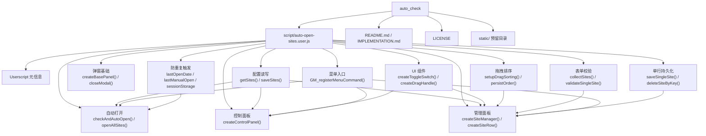

# 项目实现说明文档

本文档基于当前项目目录和源码编写，记录 `每日自动打开网站` Tampermonkey 脚本的实现方式、模块职责、关键技术选择、边界处理和验证方式。

当前主源码文件为：

- [script/auto-open-sites.user.js](script/auto-open-sites.user.js)

## 1. 项目概述

### 1.1 项目背景

本项目是一个 Tampermonkey 用户脚本，用于在每天首次访问网页时自动打开一组常用网站。用户可以通过 Tampermonkey 菜单进入控制面板或管理面板，对网站列表进行可视化维护。

项目适合每天需要固定访问控制台、后台系统、工具站或个人常用页面的场景。

### 1.2 项目目标

- 每天只自动打开一次启用状态的网站，避免重复打开。
- 脚本仅在顶层页面运行（`@noframes`），避免在 iframe 中重复实例化导致菜单命令被多次触发。
- 支持手动打开所有启用网站。
- 支持单独打开某个启用网站。
- 支持新增、修改、删除网站。
- 支持每行独立保存（新增/编辑后单行即时持久化），也保留底部“保存配置”做批量提交。
- 删除已保存网站时立即从存储移除，删除前弹出二次确认。
- 支持启用/禁用单个网站。
- 支持通过拖拽把手调整网站顺序，拖拽结束后立即持久化顺序。
- 支持保存前校验重复名称和重复 URL。
- 支持将网站配置持久化到 Tampermonkey 存储。
- 支持重置当天自动打开记录。

### 1.3 当前技术栈

- JavaScript
- Tampermonkey Userscript API
- 浏览器 DOM API
- 浏览器 `URL` API
- 浏览器 `sessionStorage`

项目没有发现 `package.json`、`requirements.txt` 或其他依赖管理文件；没有构建工具和自动化测试框架。

## 2. 当前目录结构

```text
F:\program\js\auto_check
├── script
│   └── auto-open-sites.user.js
├── static
├── IMPLEMENTATION.md
├── LICENSE
└── README.md
```

文件说明：

| 路径 | 作用 |
| --- | --- |
| `script/auto-open-sites.user.js` | Tampermonkey 用户脚本主文件 |
| `static/` | 当前为空，可能预留给后续静态资源，需要人工确认 |
| `IMPLEMENTATION.md` | 本实现说明文档 |
| `README.md` | 面向 GitHub 的项目说明 |
| `LICENSE` | MIT License |

## 3. 项目架构

虽然当前实现是单脚本文件，但代码按职责拆成了多个函数模块。



### 3.1 整体运行流程

1. Tampermonkey 根据 userscript 头部元信息注入脚本。
2. 脚本执行 IIFE，并启用 `'use strict'`。
3. 定义存储 key、默认网站、弹窗 id 和所有函数。
4. 注册 Tampermonkey 菜单命令：
   - `打开控制面板`
   - `管理网站`
   - `立即打开所有网站`
   - `重置今日记录`
5. 启动阶段读取 `lastManualOpen` 和 `sessionStorage.autoOpenChecked`。
6. 如果当前标签页未检查过，且不是刚由脚本打开的新标签页，则调用 `checkAndAutoOpen()`。
7. `checkAndAutoOpen()` 根据 `lastOpenDate` 判断今天是否已经自动打开过。
8. 如果今天没有打开过，则调用 `openAllSites()` 尝试打开网站。
9. 只有 `openAllSites()` 确实安排了打开标签页时，才写入今天日期。
10. `openAllSites()` 读取启用状态的网站，并通过 `GM_openInTab()` 间隔打开。

对应启动逻辑：

```js
const lastManualOpen = GM_getValue(STORAGE_KEY_LAST_MANUAL_OPEN, 0);
const now = Date.now();
const isRecentlyManuallyOpened = lastManualOpen && (now - lastManualOpen) < 10000;

if (!sessionStorage.getItem('autoOpenChecked') && !isRecentlyManuallyOpened) {
    sessionStorage.setItem('autoOpenChecked', 'true');
    checkAndAutoOpen();
}
```

## 4. 分模块实现说明

### 4.1 Userscript 元信息模块

**模块作用**

声明脚本名称、版本、作者、运行范围、授权 API 和运行时机。

**源码位置**

`script/auto-open-sites.user.js` 顶部：

```js
// @name         每日自动打开网站
// @version      1.6
// @author       gcnanmu
// @match        *://*/*
// @grant        GM_getValue
// @grant        GM_setValue
// @grant        GM_registerMenuCommand
// @grant        GM_openInTab
// @run-at       document-start
// @noframes
```

**设计原因**

- `@match *://*/*`：需要在任意网页上触发每日检查。
- `@run-at document-start`：尽早执行自动打开判断。
- `@grant`：显式声明使用 Tampermonkey 存储、菜单和打开标签页能力。
- `@noframes`：脚本只在顶层文档运行，不在 iframe 中实例化。

**边界情况**

由于脚本在 `document-start` 执行，此时 `document.body` 可能还不存在。因此需要 DOM 的控制面板和管理面板必须通过 `ensureBodyReady()` 延迟执行。

### 4.2 配置常量与默认网站模块

**模块作用**

集中定义 Tampermonkey 存储 key、弹窗 DOM id 和默认网站。

**关键代码**

```js
const STORAGE_KEY_SITES = 'managedSites';
const STORAGE_KEY_LAST_OPEN_DATE = 'lastOpenDate';
const STORAGE_KEY_LAST_MANUAL_OPEN = 'lastManualOpen';
const PANEL_ID = 'auto-open-panel';
const OVERLAY_ID = 'auto-open-overlay';
const MANAGER_ID = 'auto-open-manager';

const DEFAULT_SITES = [
    { name: 'AnyRouter', url: 'https://anyrouter.top/console', enabled: true }
];
```

**数据结构**

```js
{
    name: string,
    url: string,
    enabled: boolean
}
```

**设计原因**

存储 key 和 DOM id 被多个函数复用。集中定义可以避免字符串散落，降低拼写错误导致配置丢失、弹窗无法关闭等问题。

**边界情况**

当前 `getSites()` 只在没有保存过配置，或存储值不是数组时回退到 `DEFAULT_SITES`。如果用户明确保存了空数组，则返回空数组并保持网站列表为空。

这样设计是为了让“删除全部网站并保存”真正生效。如果列表为空，自动打开逻辑不会触发，也不会写入今日已打开记录。

### 4.3 网站配置读写模块

**涉及函数**

- `getSites()`
- `saveSites(sites)`

**核心逻辑**

`getSites()` 从 Tampermonkey 存储读取 `managedSites`，并做运行时清洗：

```js
return storedSites
    .filter((site) => site && typeof site.name === 'string' && typeof site.url === 'string')
    .map((site) => ({
        name: site.name.trim(),
        url: site.url.trim(),
        enabled: site.enabled !== false
    }))
    .filter((site) => site.name && site.url);
```

**为什么这样设计**

Tampermonkey 存储没有编译期类型约束。用户可能升级脚本、导入旧数据或手动修改存储，因此读取时必须做防御式处理。

`enabled: site.enabled !== false` 的含义是：只有明确保存为 `false` 才禁用，旧配置缺失 `enabled` 字段时默认启用，避免升级后所有网站突然不可用。

**与其他模块交互**

- `openAllSites()` 读取启用网站。
- `createControlPanel()` 读取全部网站，用于打开和快速启用/禁用。
- `createSiteManager()` 读取全部网站，用于编辑。
- `collectSites()` 校验后调用 `saveSites()`。

**验证方式**

- 修改网站列表并保存，重新打开管理面板检查是否持久化。
- 手动构造缺少 `enabled` 的旧配置，确认默认启用。
- 输入空名称或空 URL，确认不会保存。

### 4.4 自动打开模块

**涉及函数**

- `getTodayString()`
- `checkAndAutoOpen()`
- `openAllSites()`

**核心逻辑**

`checkAndAutoOpen()` 负责每日判断：

```js
if (lastOpenDate !== today) {
    openAllSites({ silentEmpty: true });
    return;
}
```

`openAllSites()` 只打开启用网站：

```js
const sites = getSites().filter((site) => site.enabled);
```

`lastOpenDate` 的写入集中在 `openAllSites()` 内，手动打开和每日自动打开共用同一份记录：

```js
GM_setValue(STORAGE_KEY_LAST_MANUAL_OPEN, Date.now());
GM_setValue(STORAGE_KEY_LAST_OPEN_DATE, getTodayString());
```

**为什么这样设计**

只有在 `openAllSites()` 确实安排了打开标签页时，才写入 `lastOpenDate`。如果网站列表为空，或者没有任何启用网站，则不会算作今日已触发。

把写入放在 `openAllSites()` 而不是 `checkAndAutoOpen()` 里，是因为“立即打开所有网站”菜单和控制面板的“打开所有网站”按钮也调用同一个函数。如果这两处不计入今日记录，用户上午手动打开一次，下午访问新页面时脚本仍会再自动打开一遍。

列表为空时会输出：

```text
当前网站列表为空，不触发自动打开逻辑
```

每个网站间隔 500ms 打开，是为了降低浏览器批量弹窗拦截概率。

**边界情况**

- 如果没有启用网站，会提示用户添加或启用网站。
- 如果网站列表为空，自动检查只打印日志，不弹窗、不写入今日记录。
- `getTodayString()` 使用 UTC 日期，东八区凌晨可能与本地日期存在差异，需要人工确认是否改成本地日期。

**验证方式**

- 首次访问页面应触发自动打开。
- 同一天再次访问页面不应重复打开。
- 禁用网站不应被 `openAllSites()` 打开。
- 保存空网站列表后访问页面，应只打印“当前网站列表为空，不触发自动打开逻辑”，且不写入 `lastOpenDate`。
- 点击“立即打开所有网站”后，当天访问新页面不应再自动打开。

### 4.5 防重复触发模块

**涉及状态**

| 状态 | 存储位置 | 作用 |
| --- | --- | --- |
| `lastOpenDate` | Tampermonkey 存储 | 控制今天是否已经打开过（手动或自动） |
| `lastManualOpen` | Tampermonkey 存储 | 控制刚由脚本打开的新标签页不再重复触发 |
| `autoOpenChecked` | `sessionStorage` | 控制当前标签页只检查一次 |

**核心逻辑**

```js
const isRecentlyManuallyOpened = lastManualOpen && (now - lastManualOpen) < 10000;

if (!sessionStorage.getItem('autoOpenChecked') && !isRecentlyManuallyOpened) {
    sessionStorage.setItem('autoOpenChecked', 'true');
    checkAndAutoOpen();
}
```

**为什么这样设计**

脚本匹配所有网页，新打开的网站也会再次运行脚本。如果只用 `lastOpenDate`，虽然能防止当天重复打开，但新标签页仍会执行检查逻辑。组合使用 `sessionStorage` 和 `lastManualOpen` 可以减少无意义检查和连锁触发。

**重置逻辑**

当前 `重置今日记录` 会清理三个状态：

```js
GM_setValue(STORAGE_KEY_LAST_OPEN_DATE, '');
GM_setValue(STORAGE_KEY_LAST_MANUAL_OPEN, 0);
sessionStorage.removeItem('autoOpenChecked');
```

这是因为只清 `lastOpenDate` 不够。同一标签页里 `autoOpenChecked` 仍存在时，访问新页面仍不会进入每日检查。

### 4.6 弹窗基础模块

**涉及函数**

- `ensureBodyReady(callback)`
- `closeModal(panelId)`
- `createOverlay()`
- `createBasePanel(panelId, titleText, width)`

**模块作用**

提供控制面板和管理面板共用的弹窗创建、遮罩创建和关闭逻辑。

**设计原因**

项目运行在任意网页上，不能假设页面结构和样式环境。统一通过原生 DOM 创建固定定位弹窗，并使用较高 `z-index` 保证可见。

`createBasePanel()` 创建新面板前会关闭已有面板，避免控制面板和管理面板叠在一起。

**边界情况**

- `document.body` 不存在时，通过 `DOMContentLoaded` 延迟执行。
- 点击遮罩关闭弹窗时，同时移除面板和遮罩，避免遮罩残留导致页面无法点击。

### 4.7 控制面板模块

**涉及函数**

- `createControlPanel()`
- `updateSiteEnabled(targetIndex, enabled)`
- `createToggleSwitch(checked, onChange)`

**模块作用**

控制面板是日常快捷入口，提供：

- 单独打开某个启用网站。
- 使用滑动开关立即启用/禁用某个网站。
- 手动打开所有启用网站。
- 进入管理网站界面。

**实现方式**

控制面板读取全部网站，而不是只读取启用网站。这样禁用网站仍会展示，用户可以从这里重新启用。

控制面板中的启用/禁用是即时保存：

```js
const toggleSwitch = createToggleSwitch(site.enabled, (nextEnabled) => {
    updateSiteEnabled(index, nextEnabled);
    createControlPanel();
});
```

**为什么这样设计**

控制面板属于快捷操作场景，用户点击开关后通常希望立即生效。因此这里不等待“保存配置”，而是马上写入 Tampermonkey 存储并重绘面板。

**边界情况**

禁用网站点击打开时，会提示先启用，不会调用 `GM_openInTab()`。

### 4.8 UI 组件模块

**涉及函数**

- `createActionButton(...)`
- `createSmallButton(...)`
- `createToggleSwitch(checked, onChange)`
- `createDragHandle()`

**滑动开关**

`createToggleSwitch()` 使用 `button` + 内部 `span` 实现，设置 `role="switch"` 和 `aria-checked`，用背景色和滑块位置表达状态。

选择自定义开关的原因：

- 浏览器原生 checkbox 难以在 userscript 中稳定控制样式。
- 自定义样式可以避免被目标网页 CSS 影响。
- `role="switch"` 保留了基础语义。

**拖拽把手**

`createDragHandle()` 只让左侧胶囊形把手可拖，而不是整行可拖。原因：

- 避免拖拽影响点击行展开/收起。
- 避免展开后选择输入框文本时误触拖拽。
- 用户更容易理解“按住把手排序”的交互。

### 4.9 管理面板模块

**涉及函数**

- `createSiteManager()`
- `createSiteRow(site, listContainer, expandedByDefault)`
- `validateSingleSite(site)`
- `saveSingleSite(site, prevKey)`
- `deleteSiteByKey(key)`
- `persistOrder(listContainer)`
- `createField(...)`
- `getUrlDisplay(url)`
- `createEmptyRowHint()`
- `clearEmptyHint(container)`

**模块作用**

管理网站配置，支持：

- 新增网站
- 修改名称和 URL
- 启用/禁用网站
- 拖拽排序（拖拽结束后立即持久化顺序）
- 删除网站，删除前需要二次确认，已保存的网站立即从存储移除
- 每行独立保存，或底部“保存配置”批量提交，或“取消”放弃本次面板临时修改

**行结构**

每个网站行由三部分组成：

```text
拖拽把手 | 摘要信息 | 开关 / 编辑 / 删除
```

展开后显示名称、网址输入框，以及该行独立的“保存”按钮。

**行标识**

从存储渲染出来的行会带 `data-site-key`（URL 小写），作为单行保存/删除和排序持久化时在存储中定位自身的稳定 key。新增但未保存的行没有 `data-site-key`：

```js
if (site.url) {
    row.dataset.siteKey = site.url.trim().toLowerCase();
}
```

**保存策略**

管理面板同时提供两种保存路径：

- **每行独立保存**：展开后点击行内“保存”按钮，调用 `saveSingleSite()` 只校验并写入这一个网站，避免每次小改动都走全量收集逻辑。保存成功后更新该行 `data-site-key`，后续编辑基于新 key 原地更新。
- **底部批量保存**：点击 `保存配置` 后，`collectSites()` 按当前 DOM 顺序读取所有行并整体写入，适合一次性批量改动。

启用状态、输入框内容仍先停留在 DOM 中。点击“取消”可放弃尚未保存的临时修改。拖拽排序与删除已保存网站则会即时持久化（见 4.10、4.11.1）。

**关键导出**

```js
row.getSiteData = () => ({
    name: nameField.input.value.trim(),
    url: urlField.input.value.trim(),
    enabled
});
```

这个设计降低了 `collectSites()` 对行内部 DOM 结构的耦合。

### 4.10 拖拽排序模块

**涉及函数**

- `setupDragSorting(listContainer)`
- `createDragHandle()`
- `persistOrder(listContainer)`

**核心逻辑**

拖拽开始时，当前行被临时挂到容器上：

```js
listContainer.draggedRow = row;
```

拖拽经过其他行时，比较鼠标位置和目标行中线：

```js
const shouldInsertAfter = event.clientY > targetRect.top + targetRect.height / 2;
listContainer.insertBefore(draggedRow, shouldInsertAfter ? targetRow.nextSibling : targetRow);
```

拖拽结束（`dragend`）后立即按当前 DOM 顺序持久化，`persistOrder()` 只重排带 `data-site-key` 的已保存行，未保存的新行不参与：

```js
dragHandle.ondragend = () => {
    listContainer.draggedRow = null;
    refreshSummary();
    persistOrder(listContainer);
};
```

**为什么这样设计**

原生 HTML Drag and Drop 足够满足当前需求，不需要引入外部库。排序本质是 DOM 节点移动，结束后按 DOM 顺序读取并写回即可，让排序无需再点底部“保存配置”就能生效。

**边界情况**

- 拖到自己身上不处理。
- 拖到非网站行不处理。
- 拖拽结束后清理 `listContainer.draggedRow`。
- `persistOrder()` 只处理已保存行；存储中存在但当前列表未覆盖的网站会被追加到末尾，避免丢数据。

### 4.11.0 单行持久化模块

**涉及函数**

- `validateSingleSite(site)`
- `saveSingleSite(site, prevKey)`
- `deleteSiteByKey(key)`

**模块作用**

让管理面板的每行“保存”按钮和“删除”按钮只影响单个网站，避免每次小改动都触发 `collectSites()` 的全量收集与去重。

**保存单行（upsert）**

`saveSingleSite()` 先用 `validateSingleSite()` 校验名称/URL，再结合当前存储做冲突校验并写入：

```js
const selfIndex = prevKey === null
    ? -1
    : sites.findIndex((item) => item.url.toLowerCase() === prevKey);

// 排除自身后检测重名（拒绝）和重 URL（确认后覆盖）
```

- `prevKey` 是该行上次保存使用的 URL（小写）；新行为 `null`，按新增处理。
- 与“其他”网站重名直接拒绝；与“其他”网站 URL 重复需确认覆盖，确认后移除旧记录再写入。
- 成功返回新的 URL key，行会用它更新 `data-site-key`。

**删除单行**

`deleteSiteByKey()` 按 key 过滤后写回存储：

```js
const sites = getSites().filter((item) => item.url.toLowerCase() !== key);
saveSites(sites);
```

已保存过的行删除后立即从存储移除；未保存的新行没有 key，调用方只移除 DOM。

**为什么这样设计**

每行独立保存/删除/排序都即时生效且互不干扰，符合“小改动不应触发全量重复逻辑”的诉求；底部“保存配置”仍保留用于批量提交。

### 4.11 表单校验模块

**涉及函数**

- `collectSites(listContainer)`

**校验规则**

- 名称不能为空。
- URL 不能为空。
- URL 必须以 `http://` 或 `https://` 开头。
- 名称不能重复，重复时提示“名称重复，请更换”。
- URL 重复时会询问是否覆盖已有配置；用户确认后，使用当前行覆盖旧行。

**核心逻辑**

```js
const rows = Array.from(listContainer.children).filter((child) => typeof child.getSiteData === 'function');
const sites = rows.map((row) => row.getSiteData());
```

只收集拥有 `getSiteData()` 的行，因此空状态提示不会被误当作网站。

重复处理的核心策略：

```js
if (nameSet.has(nameKey)) {
    alert(`名称重复：${site.name}\n请更换网站名称。`);
    return null;
}

if (urlIndexByKey.has(urlKey)) {
    const shouldOverwrite = confirm('是否用当前网站配置覆盖已有配置？');
    if (!shouldOverwrite) {
        return null;
    }
    // 移除之前相同 URL 的配置，再写入当前配置。
}
```

名称重复会直接阻止保存，因为同名网站在控制面板和管理面板里难以区分。URL 重复允许覆盖，是因为用户可能只想更新同一地址对应的名称或启用状态。

**未处理事项**

- 未使用 `new URL()` 作为保存校验。

是否需要使用更严格的 URL 解析校验，需要人工确认。

### 4.12 菜单命令模块

**涉及代码**

```js
GM_registerMenuCommand('打开控制面板', () => {
    ensureBodyReady(createControlPanel);
});

GM_registerMenuCommand('管理网站', () => {
    ensureBodyReady(createSiteManager);
});

GM_registerMenuCommand('立即打开所有网站', () => {
    openAllSites();
});

GM_registerMenuCommand('重置今日记录', () => {
    GM_setValue(STORAGE_KEY_LAST_OPEN_DATE, '');
    GM_setValue(STORAGE_KEY_LAST_MANUAL_OPEN, 0);
    sessionStorage.removeItem('autoOpenChecked');
    alert('今日记录已重置，下次访问或刷新页面会再次触发自动打开。');
});
```

**设计原因**

Tampermonkey 菜单不会污染目标网页 UI，也不需要在每个页面插入固定按钮。需要 DOM 的命令通过 `ensureBodyReady()` 执行，不依赖 DOM 的命令直接执行。

“立即打开所有网站”复用 `openAllSites()`，因此同样会写入 `lastOpenDate`，点击后当天不会再被自动打开。

## 5. 稳定性与正确性保障

### 5.1 参数校验

当前主要校验在 `collectSites()`：

- 名称不能为空。
- URL 不能为空。
- URL 必须有 `http://` 或 `https://` 协议。
- 名称不能重复。
- URL 重复时需要用户确认覆盖。

配置读取时 `getSites()` 还会做类型检查和清洗。

### 5.2 异常处理

`getUrlDisplay(url)` 使用 `try...catch`：

```js
try {
    return new URL(url).hostname;
} catch (error) {
    return url || '未设置网址';
}
```

这样可以避免用户新增网站时输入不完整 URL 导致管理面板崩溃。

### 5.3 日志

当前日志集中在每日打开判断：

```js
console.log('[每日自动打开网站]: 检测到今天首次打开浏览器，正在打开网站...');
console.log('[每日自动打开网站]: 今天已经打开过，跳过自动打开');
```

是否需要增加每个网站打开日志，需要人工确认。

### 5.4 类型检查

项目没有 TypeScript。当前依赖运行时类型检查：

```js
Array.isArray(storedSites)
typeof site.name === 'string'
typeof site.url === 'string'
typeof child.getSiteData === 'function'
```

### 5.5 测试与验证

当前没有测试框架。可做语法检查：

```powershell
node -e "new Function(require('fs').readFileSync('script/auto-open-sites.user.js','utf8')); console.log('syntax ok')"
```

人工验证建议：

1. 安装或更新 Tampermonkey 脚本。
2. 打开任意网页。
3. 打开控制面板，确认网站和滑动开关显示正常。
4. 切换控制面板中的启用状态，确认立即保存。
5. 打开管理面板，新增网站后点击该行“保存”按钮，确认单行即时持久化。
6. 编辑已有网站后点击该行“保存”，确认在存储中原地更新而非新增。
7. 拖拽排序后无需点底部按钮，重新打开管理面板确认顺序保留。
8. 删除一个已保存网站，确认立即从存储移除（重新打开面板不再出现）。
9. 使用底部“保存配置”做一次批量修改，确认整体写入按当前 DOM 顺序生效。
10. 禁用网站后点击“立即打开所有网站”，确认禁用网站不会打开。
11. 删除网站时确认弹出二次确认框。
12. 单行保存时输入与其他网站重复的名称，确认提示名称重复并阻止保存。
13. 单行保存时输入与其他网站重复的 URL，确认弹出覆盖确认；确认覆盖后旧配置被当前行替换。
14. 保存空网站列表，访问新页面时确认控制台打印“当前网站列表为空，不触发自动打开逻辑”，且不会写入今日记录。
15. 点击“重置今日记录”，访问新页面或刷新页面，确认会重新触发自动打开检查。
16. 在包含 iframe 的页面点击“立即打开所有网站”，确认只打开一次（每个启用网站一个标签页），不再随 iframe 数量翻倍。

### 5.6 已处理边界场景

- `document.body` 不存在时延迟创建面板。
- 脚本通过 `@noframes` 只在顶层文档运行，避免在 iframe 中重复实例化导致菜单命令多次触发、打开数量随帧数翻倍。
- 存储数据非法时清洗或回退默认配置。
- 旧配置缺少 `enabled` 字段时默认启用。
- URL 摘要解析失败时 fallback。
- 删除最后一行后显示空状态。
- 删除网站前需要二次确认，已保存网站删除后立即从存储移除。
- 删除、编辑、开关点击使用 `event.stopPropagation()` 避免误触发行展开/收起。
- 单行保存与批量保存均校验重复名称（拒绝）和重复 URL（确认覆盖）。
- 拖拽排序在 `dragend` 后立即持久化，只处理已保存行。
- 保存空网站列表后保持为空，不回退默认网站。
- 空网站列表不会触发自动打开，也不会写入今日记录。
- 重置今日记录时同时清理 `lastOpenDate`、`lastManualOpen` 和 `autoOpenChecked`。

### 5.7 需要人工确认的事项

- 日期判断是否应从 UTC 改成本地日期。
- 是否需要对 URL 使用 `new URL()` 做更严格的保存校验。
- 是否需要导入/导出配置。
- `static/` 目录当前为空，其用途需要确认。
- `LICENSE` 中版权主体仍为 `[fullname]`，需要替换为实际作者或组织。

## 6. 开发问题与解决方案

### 6.1 网站配置不应继续写死在源码里

**问题**

如果所有网站都写在 `DEFAULT_SITES`，用户新增或删除网站必须修改源码。

**解决**

使用 `GM_getValue` / `GM_setValue` 持久化 `managedSites`，并提供 `createSiteManager()` 作为可视化管理入口。

### 6.2 网站多时管理界面不够紧凑

**问题**

完整表单展开会占用大量垂直空间。

**解决**

`createSiteRow()` 使用折叠行，默认只展示摘要；点击编辑才展开输入框。

### 6.3 文字按钮交互不够直观

**问题**

“启用/禁用”“拖动”文字按钮视觉上不够像状态控件和排序控件。

**解决**

使用 `createToggleSwitch()` 创建滑动开关，使用 `createDragHandle()` 创建胶囊形拖拽把手。

### 6.4 重置今日记录后仍不触发

**问题**

早期只清理 `lastOpenDate`，但当前标签页中的 `sessionStorage.autoOpenChecked` 仍存在，导致访问新页面不再执行检查。

**解决**

重置时同时清理：

```js
GM_setValue(STORAGE_KEY_LAST_OPEN_DATE, '');
GM_setValue(STORAGE_KEY_LAST_MANUAL_OPEN, 0);
sessionStorage.removeItem('autoOpenChecked');
```

### 6.5 脚本匹配所有网页容易重复触发

**问题**

脚本打开的新标签页也会运行脚本。

**解决**

组合使用：

- `lastOpenDate`
- `lastManualOpen`
- `sessionStorage.autoOpenChecked`

从日期、短时间窗口、当前标签页三个层面降低重复触发风险。

### 6.6 删除全部网站后默认网站又出现

**问题**

早期 `getSites()` 在存储数组为空时也回退到 `DEFAULT_SITES`，导致用户删除全部网站并保存后，重新打开管理面板仍会看到默认网站。

**解决**

现在 `getSites()` 只在没有保存过配置或存储值不是数组时回退默认列表；如果用户明确保存了空数组，就返回空数组。

自动打开逻辑遇到空列表时只打印：

```text
当前网站列表为空，不触发自动打开逻辑
```

并且不会写入 `lastOpenDate`，因此不算今日已经触发过。

### 6.7 重复名称和重复 URL 的处理策略

**问题**

重复名称会让用户在控制面板和管理面板里难以区分网站；重复 URL 则可能代表用户想更新已有配置。

**解决**

- 名称重复：直接提示用户更换名称，并阻止保存。
- URL 重复：弹出确认框；用户确认后，用当前行覆盖已有 URL 对应的旧配置。

这样既避免同名混淆，又保留了用新配置覆盖旧 URL 的操作空间。

### 6.8 “立即打开所有网站”数量随标签页/iframe 翻倍

**问题**

脚本使用 `@match *://*/*` 且未声明 `@noframes`，会在页面的每个 iframe 中各实例化一份，并各自注册菜单命令。点击“立即打开所有网站”时，多个实例都会执行 `openAllSites()`，导致打开数量约等于“启用网站数 × 运行实例数”，页面 iframe 越多翻得越多。

**解决**

在 userscript 元信息中加入 `@noframes`，让脚本只在顶层文档运行，每个标签页只有一个实例、只注册一次菜单、点击只触发一次。其余逻辑保持不变。

### 6.9 每次小改动都触发全量保存逻辑

**问题**

早期管理面板只有底部“保存配置”，任何一次小修改都要走 `collectSites()` 的全量收集与重名/重 URL 去重，既繁琐又容易在多行间产生不必要的交互。

**解决**

新增 `saveSingleSite()` / `deleteSiteByKey()` / `persistOrder()`，为每行提供独立“保存”按钮、删除即时持久化、拖拽排序即时持久化。每行用 `data-site-key`（URL 小写）在存储中定位自身，做 upsert；底部“保存配置”保留用于批量提交。

### 6.10 手动打开后当天仍会被自动打开

**问题**

早期只有 `checkAndAutoOpen()` 写入 `lastOpenDate`，`openAllSites()` 不写。用户点击“立即打开所有网站”或控制面板的“打开所有网站”后，`lastOpenDate` 仍是旧值，当天访问新页面时脚本会再自动打开一遍。

**解决**

把 `lastOpenDate` 的写入移进 `openAllSites()`，紧跟在 `lastManualOpen` 之后，手动打开和自动打开共用同一份今日记录：

```js
GM_setValue(STORAGE_KEY_LAST_MANUAL_OPEN, Date.now());
GM_setValue(STORAGE_KEY_LAST_OPEN_DATE, getTodayString());
```

两个提前返回（列表为空、没有启用网站）仍在写入之前，所以“空列表不算今日已触发”的语义不变。

## 7. 总结与后续优化

当前项目是一个轻量 Tampermonkey 自动打开网站脚本。实现上保持单文件运行、无构建依赖，通过原生 DOM 实现控制面板和管理面板，通过 Tampermonkey 存储保存网站配置。

当前已具备：

- 每日自动打开。
- 仅在顶层页面运行（`@noframes`），避免 iframe 重复触发。
- 手动打开所有启用网站，且计入今日记录，当天不会再被自动打开。
- 控制面板快速打开和即时启用/禁用。
- 管理面板新增、修改、删除、启用/禁用、拖拽排序。
- 每行独立保存与删除即时持久化，拖拽排序即时持久化，底部“保存配置”批量提交。
- 防重复触发。
- 重置今日记录。
- 删除二次确认。
- 重复名称校验。
- 重复 URL 覆盖确认。
- 空网站列表保持为空且不触发自动打开。
- README Mermaid 项目结构图。

后续建议：

- 将 UTC 日期判断改成本地日期，需要人工确认。
- 增加搜索或筛选。
- 增加导入/导出配置。
- 增加更严格的 URL 合法性校验。
- 如果 UI 继续复杂化，可以考虑拆出 CSS 或资源文件到 `static/`。
- 如果逻辑继续增加，可以拆分纯函数并补充单元测试。
